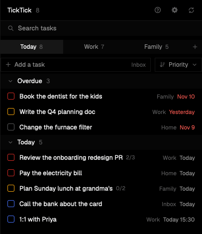
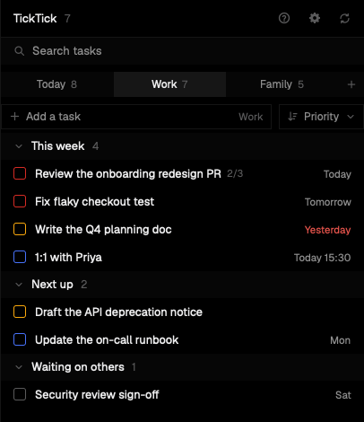
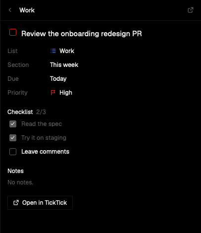

# TickTick panel

**Your TickTick tasks in a [Herdr](https://herdr.dev) side panel, next to your terminals.**



The panel shows one view at a time. A view is a saved query (`due:today`,
`list:smile`, `pri:high tag:errands`), and each one is a tab with its task
count. Tasks show in sections, as in the app: a view on one list shows that
list's sections, and any other view shows date sections (Overdue, Today,
Tomorrow, Next 7 Days, Later, No Date). Within a section, tasks are sorted by
priority unless you pick another order.

From the panel you can complete a task, add one, and change a task's list,
due date, priority and checklist. You can also open it in TickTick.

| A list's own sections | A task |
|---|---|
|  |  |

The screenshots show made-up tasks.

## Requirements

- The Herdr app.
- A TickTick personal API token in `$TICKTICK_TOKEN`. To make one, open
  [TickTick's web app](https://ticktick.com/webapp/) and go to your avatar →
  **Settings** → **Account** → **API Token**. Then export it from a file your
  shell reads:

  ```sh
  # ~/.zshrc, or a secrets file it sources
  export TICKTICK_TOKEN="your token"
  ```

The panel looks for the variable in Herdr's environment first. If it isn't
there, it asks your interactive shell (`$SHELL -ic`), so a variable set in
`~/.zshrc` works even when Herdr was started from the Dock. The token is never
written anywhere. If it's missing or TickTick refuses it, the panel says how
to fix that.

## Install

1. Clone this repo and copy the mod into Herdr:

   ```sh
   git clone https://github.com/lucasprag/herdr-tick-tick ~/Projects/herdr-tick-tick
   ~/Projects/herdr-tick-tick/scripts/install-mod.sh
   ```

   The script copies `app/mods/tick-tick` to
   `~/.config/herdr-app/mods/tick-tick` (or `$HERDR_APP_HOME/mods/...`) and
   runs `herdr-app check` on it. Run it again after every pull.

2. Put the panel in your layout. Its `mod.json` has `"place": "none"`, so Herdr
   doesn't add it anywhere on its own. Add a block to a side panel stack, for
   example the `panel-body` stack of a layout cloned from `main`:

   ```json
   { "id": "tasks", "type": "block", "content": { "mod": "tick-tick" } }
   ```

   Then add a button that shows it, for example in a clone of the `tabs` mod,
   using the panel's own icon:

   ```js
   run("layout.select", { stack: "panel-body", child: "tasks" });
   run("layout.show", { id: "panel" });
   // icon: svg("mods/tick-tick/tasks.svg")
   ```

   Shipped layouts and mods are read-only, so clone them first
   (`layout.clone`, `mod.clone`).

## Views and queries

Views live in **Settings** (the gear), where you can add, rename, edit the
query, reorder or delete them. The `+` at the end of the tabs adds one. Out of
the box there are three:

| View | Query |
|---|---|
| Today | `due:today` |
| Work | `list:smile` |
| Family | `list:family` |

| Token | Meaning |
|---|---|
| `list:smile` `list:"Side work"` | in a list whose name contains it; `list:inbox` for the Inbox |
| `due:today` | due today or overdue, like TickTick's Today |
| `due:overdue,tomorrow` | due: `overdue`, `today`, `tomorrow`, `week` (the next 7 days, overdue too), `later`, `none` |
| `pri:high,medium` | priority: `high`, `medium`, `low`, `none` |
| `tag:errands` | has the tag |
| any other word | in the title |

- Tokens separated by spaces must all hold.
- Commas in a token mean any of: `due:overdue,tomorrow`.
- A leading `-` negates: `-tag:waiting`.
- Quote values with spaces: `list:"Side work"`.

The help button (`?`) in the panel shows the same table.

## The list

- **Search tasks** filters the shown view by title as you type.
- **Add a task** (Enter) adds a task to the view's list, or to the Inbox when
  the view has no single list. The list's name shows at the right of the box.
  The new task also takes the view's priority, tags and due day (today for
  `due:today`), so it shows up in the view.
- **Sort** sets the order within each section, one choice per view:
  - **Priority** (the default): high first, then by due date.
  - **Due date**: earliest first, then by priority.
  - **Title**.
  - **Manual**: your order from TickTick.
- **Sections:**
  - A view on exactly one list (`list:smile`) uses that list's own sections,
    with "No Section" last.
  - Every other view uses the date sections.
  - Click a section to collapse it. This is remembered per view.
- **Each line** shows:
  - a checkbox in the priority's color (click it to complete the task)
  - the title
  - the checklist progress (`2/5`)
  - the list's name, when the view spans several lists
  - the due date (red when it's overdue).
- **Click a task** to open its page. There you can change the list, due date
  (Today, Tomorrow, Next week, No date) and priority, tick checklist items,
  read its notes, and open it in TickTick.

The panel refreshes when it opens, when you click refresh, and every two
minutes. A completed repeating task comes back with its next date.

## Settings

The settings are kept in Herdr's shared state under `tick-tick.prefs`, so they
survive layout changes: the views (name, query and sort, in order), the
selected view, and collapsed sections.

## Keys

`keys.json` can send these to the panel:

- `tick-tick.refresh`
- `tick-tick.add`, which focuses Add a task
- `tick-tick.search`
- `tick-tick.help`
- `tick-tick.settings`
- `tick-tick.back`
- `tick-tick.view:<name>`
- `tick-tick.add-view:<name>=<query>`, which adds a view (or changes the
  query of the view with that name) and selects it, e.g.
  `herdr-app do 'tick-tick.add-view:Errands=tag:errands'`

Commands reach the panel only while it's in the shown layout.

## Development

Edit `app/mods/tick-tick/`, then run `scripts/install-mod.sh`; Herdr reloads
the copy right away. The query, sections and sorting (`query.js`) have no
Herdr imports, so their tests run with plain Node:

```sh
node --test
```

`app/RECIPE.md` describes the panel for anyone rebuilding it from scratch.

## Trademarks

TickTick is a trademark of its owner. This project isn't affiliated with
or endorsed by TickTick.

## License

[MIT](LICENSE)
